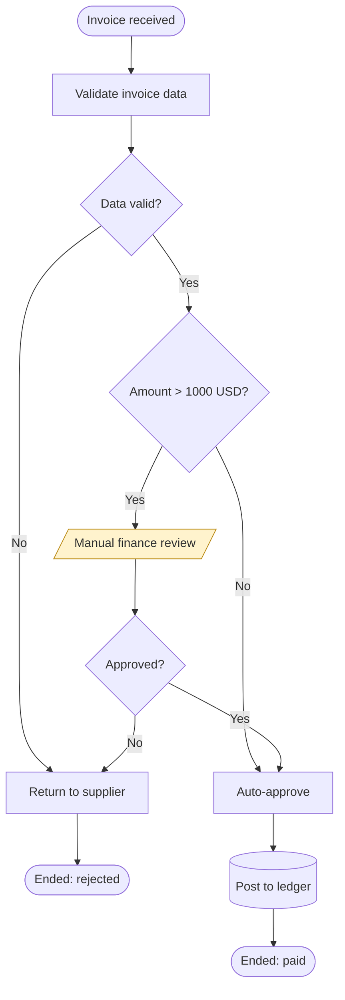

# BA Text-to-Diagram (Mermaid.js) — Virtual BA Framework, Category 2 / Skill A

Render a described process as valid Mermaid.js that renders first time.

**Agent instruction (canonical):** *Identify start/end points, decision nodes (diamonds), and action nodes (rectangles). Maintain logical flow.*

## Inputs

- **Required** — a step-by-step description of a process, or any narrative containing one.
- **Optional** — actor/department list (enables swimlanes), system list (enables sequence diagrams), diagram type, direction (`TD` default, `LR` for long linear flows), AS-IS vs TO-BE label.

## Choosing the diagram type

| The question being asked | Diagram | Mermaid header |
|---|---|---|
| What are the steps and decisions? | Flowchart | `flowchart TD` |
| Who hands off to whom? | Swimlane flowchart | `flowchart TD` + `subgraph` per actor |
| What messages pass between systems, in what order? | Sequence | `sequenceDiagram` |
| What states can this record be in? | State machine | `stateDiagram-v2` |
| What data entities relate to what? | ERD | `erDiagram` |
| What does the customer experience, step by step? | Journey | `journey` |
| When does each phase happen? | Timeline / plan | `gantt` |

Default to `flowchart TD`. When two are equally valid, produce the flowchart and offer the second.

## Shape Vocabulary (keep consistent — readers learn it once)

| Element | Mermaid | Use for |
|---|---|---|
| Start / End | `A([Start])` | exactly one start; one end per terminal outcome |
| Action / Task | `B[Validate invoice]` | work performed by an actor or system |
| Decision | `C{Amount > 1000?}` | a question with 2+ labelled exits |
| Subprocess | `D[[Run credit check]]` | a process detailed in its own diagram |
| Data / Document | `E[(Invoice DB)]` / `F[/Receipt/]` | stores and artifacts |
| Manual step | `G[/Sign paper form/]` | human, off-system work |
| Wait / Delay | `H(((SLA 48h)))` | queues and waiting time |

## Workflow

1. **Extract the flow** — list every step as `actor · action · object` before drawing. Anything with no actor is a gap; note it.
2. **Find the boundaries** — one explicit trigger (start) and every terminal outcome (approved, rejected, cancelled, expired). A process with one end node usually hides the failure paths — look for them.
3. **Find the decisions** — every "if", "unless", "depending on", "in case of". Write each as a closed question with mutually exclusive, collectively exhaustive labelled exits (`|Yes|` / `|No|`).
4. **Find the handoffs** — every change of actor. In swimlane mode each actor becomes a `subgraph`; handoffs become edges crossing subgraph borders.
5. **Draw** — top-to-bottom for process logic, left-to-right for long linear chains.
6. **Mark problems** — for AS-IS diagrams, annotate rework loops, manual steps and waits (these feed `/ba-gap-analysis`). Use a `classDef` for pain points instead of prose.
7. **Validate** before responding (checklist below).

## Syntax Rules That Prevent Broken Renders

- Quote any label containing a special character: `B["Approve (Finance)"]`. Parentheses, commas, colons, `{`/`}`, `/`, `#` and `&` in a bare label break the parse.
- Use `<br/>` for line breaks inside labels — never a literal newline.
- Node ids are short and alphanumeric (`A1`, `DEC1`); the label carries the text. Never reuse an id for a different node.
- Declare each node once, then reference the id in edges.
- Edge labels: `A -->|Yes| B`. Dotted for optional/async: `A -.->|on failure| C`.
- `subgraph` names with spaces need quotes and an id: `subgraph FIN["Finance Team"]` … `end`.
- In `sequenceDiagram`, declare every `participant` (or `actor`) up front and use `alt`/`else`/`opt`/`loop` blocks for conditional and repeated exchanges.
- No trailing semicolons mixed with newline separators; pick newlines.
- Never put a comment (`%%`) on the same line as a statement.

## Output

````markdown
## [AS-IS | TO-BE] Process: [Name]



**Legend:** stadium = start/end · rectangle = action · diamond = decision · parallelogram = manual step · cylinder = data store · amber = pain point.

### Reading the diagram
- **Trigger:** [what starts it] · **Outcomes:** [each terminal state]
- **Decision points:** [n] · **Actors:** [n] · **Manual steps:** [n]
- **Observations:** [rework loops, bottlenecks, unowned steps — plain sentences]

### Unresolved
| ID | Gap in the description | Effect on the diagram |
|---|---|---|
| Q-01 | No path stated for a supplier that never responds | Drawn as an open branch |
````

## Validation Checklist

- [ ] Every node is reachable from the start node.
- [ ] Every node has an outgoing edge, or is a terminal (stadium) node.
- [ ] Every decision has ≥2 labelled exits, mutually exclusive and collectively exhaustive.
- [ ] No dangling edge to an undeclared node id; no duplicate ids.
- [ ] Every label with a special character is quoted.
- [ ] Every `subgraph` is closed with `end`.
- [ ] Every actor in the narrative appears in the diagram (or is listed as out of scope).
- [ ] Mentally trace one happy path and one failure path end to end.

## Handoff

- AS-IS + TO-BE pair → `/ba-gap-analysis` for the delta table.
- Steps that are really requirements → `/ba-user-stories`.
- Diagrams embed directly in `/ba-brd` output and in Artifacts (Mermaid renders natively — do not load a library).
