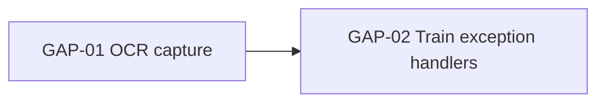

# BA Gap Analysis — Virtual BA Framework, Category 2 / Skill B

Analyse the delta between current and future state, and turn it into a register someone can act on.

**Agent instruction (canonical):** *Analyze the delta between inputs. Categorize gaps by impact level (High/Medium/Low).*

## Inputs

- **Required** — a description of the current state **and** a description of the desired future state or outcome. One without the other is not a gap analysis: if only the future state is given, ask for the current state or run `/ba-diagram` on what exists first.
- **Optional** — target date, budget/headcount constraints, regulatory drivers, existing AS-IS/TO-BE diagrams, systems inventory.

## Dimensions

Assess every dimension; state explicitly when one has no gaps.

| Dimension | Look for |
|---|---|
| **People** | Roles that do not exist, skills not held, capacity, ownership vacuums, org structure, change resistance, training |
| **Process** | Missing/manual/duplicated steps, handoffs, cycle time, exception handling, controls, policy and SLA gaps |
| **Technology** | Missing capability, integrations, licensing, scalability, security posture, technical debt, environments |
| **Data** *(when data moves or is reported on)* | Data not captured, quality, master data, migration, retention, reporting/lineage |
| **Governance** *(when regulated or multi-party)* | Decision rights, approvals, audit trail, compliance obligations, contracts |

## Workflow

1. **Normalize both states** — restate AS-IS and TO-BE as parallel capability statements so they can be compared line for line. Comparing a narrative against a wish list produces mush; comparing capability against capability produces gaps.
2. **Compute the delta per dimension** — for each capability: present / partial / absent in AS-IS versus required in TO-BE. Also record the reverse delta: things done today that TO-BE *removes* (decommissioning is work too, and it is where savings sit).
3. **Rate impact** — apply the rubric strictly rather than by feel:

   | Impact | Test — the gap is High if **any** applies |
   |---|---|
   | **High** | TO-BE cannot operate at all without closing it; it breaches a legal/contractual/security obligation; it blocks ≥2 other gaps; it puts committed revenue or the go-live date at risk |
   | **Medium** | TO-BE works but with material manual effort, cost or delay; a workaround exists but is not sustainable past go-live |
   | **Low** | Convenience, polish, or optimization; deferrable past go-live with no operational consequence |

   Ties break upward on safety, compliance and data loss; downward on aesthetics.
4. **Size the effort** — T-shirt (S / M / L / XL) with the basis stated (headcount, duration, licence cost). Never give a currency figure unless the input supplies rates.
5. **Assign a closing action and owner** — one concrete action per gap, phrased as work ("Hire or reassign one reconciliation analyst"), not as a wish ("Improve capacity"). Owner is a role, never a guessed name.
6. **Link dependencies** — which gaps must close before which. This ordering is the roadmap.
7. **Sequence** — group into Now (pre-go-live blockers) / Next (go-live enablers) / Later (optimizations) from impact and dependency, not from ease.
8. **Flag unknowns** — where the input does not say whether a capability exists, record it as an `Unknown` row with a validation question. Never score a gap you invented.

## Output

````markdown
# GAP ANALYSIS: [Initiative]

**Current state:** [1–2 lines] · **Future state:** [1–2 lines] · **Horizon:** [date/—]
**Gaps:** [n] (High [n] · Medium [n] · Low [n]) · **Unknowns:** [n]

## 1. State Comparison
| # | Capability | AS-IS | TO-BE | Delta |
|---|---|---|---|---|
| 1 | Invoice matching | Manual, 3-way in spreadsheets | Automated 3-way match | Absent |

## 2. Gap Register
| Gap ID | Dimension | Gap | Impact | Effort | Closing action | Owner | Depends on |
|---|---|---|---|---|---|---|---|
| GAP-01 | Technology | No OCR capture for supplier invoices | High | L | Procure/configure OCR in the AP suite | IT Delivery Lead | — |
| GAP-02 | People | No trained AP exception handler | Medium | S | Train 2 AP clerks on the exception queue | AP Manager | GAP-01 |

## 3. Gaps by Dimension
### People
- **[GAP-02]** [gap] — *Impact:* Medium — *Why:* [the rubric test it met] — *Action:* [action]
(repeat: Process, Technology, Data, Governance; state "No gaps identified" where true)

## 4. Reverse Delta (retired in TO-BE)
| Item | Currently | Disposition | Note |
|---|---|---|---|

## 5. Closure Sequence

| Phase | Gaps | Rationale |
|---|---|---|
| Now (blockers) | GAP-01 | Nothing else can start |
| Next | GAP-02 | Needs the tool in place |
| Later | — | |

## 6. Unknowns to Validate
| ID | Question | Dimension | Ask | Why it matters |
|---|---|---|---|---|
| U-01 | Does the ERP expose an invoice API? | Technology | IT Architecture | Decides GAP-01 effort: M vs XL |

## 7. Risks of Not Closing
| Gap ID | If not closed | Likelihood | Consequence |
|---|---|---|---|
````

## Quality Bar

- [ ] Every gap names the capability, not a vague theme ("poor communication" is not a gap).
- [ ] Every High rating cites the rubric test it met.
- [ ] Every gap has exactly one owner role and one concrete action.
- [ ] Dependencies form no cycles.
- [ ] Reverse delta considered, even if empty.
- [ ] Nothing scored from inference where the input is silent — that is an Unknown.

## Handoff

- Visualize either state → `/ba-diagram`.
- Turn closing actions into backlog items → `/ba-user-stories`.
- Feed "Risks of not closing" into `/ba-raid`.
- Fold the register into a business case → `/ba-brd`.
