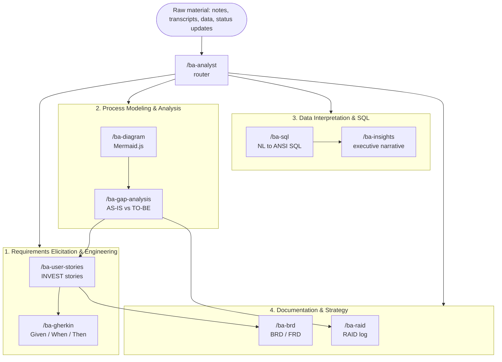

# Virtual Business Analyst Framework — User Guide

Eight Claude Code skills that cover the business analysis life cycle end to end, plus a router that picks between them. Each skill is a technique a BA actually uses; together they take raw stakeholder material to a backlog, a diagram, a query, a document or a risk log without the analyst having to say which technique they want.



---

## 1. The eight capabilities

| # | Phase | Skill | Input | Output |
|---|---|---|---|---|
| 1A | Elicitation | `/ba-user-stories` | Raw notes, transcripts, feature requests | Atomic INVEST stories (markdown + JSON), MoSCoW priority, points, open questions |
| 1B | Elicitation | `/ba-gherkin` | A user story | A valid `.feature` file: happy, alternate, boundary, error, permission, NFR scenarios |
| 2A | Modeling | `/ba-diagram` | A process described in text | Valid Mermaid.js — flowchart, swimlane, sequence, state, ERD, journey |
| 2B | Modeling | `/ba-gap-analysis` | AS-IS + TO-BE descriptions | Gap register across People / Process / Technology / Data / Governance, High-Medium-Low impact |
| 3A | Data | `/ba-sql` | A business question + a schema | ANSI SQL, term mapping, assumptions, plain-language read-back |
| 3B | Data | `/ba-insights` | CSV, JSON, query results | Executive narrative: headline, findings, outliers, recommendations, limits |
| 4A | Documentation | `/ba-brd` | Scattered notes, features, constraints, goals | Formal BRD/FRD with traceability and sign-off |
| 4B | Documentation | `/ba-raid` | Status updates, standups, steering packs | Scored RAID log + project health + escalations |
| — | Router | `/ba-analyst` | Anything, or an unclear ask | Picks and chains the above |

Invoke a skill directly when you know the deliverable (`/ba-gherkin` on a story). Use `/ba-analyst` when you have material and want a BA to tell you what is worth producing from it.

---

## 2. Design principles shared by all eight

These are enforced inside each skill, and they are what separates the output from a plausible-sounding draft:

1. **Traceability over fluency.** Every story carries the source quote, every gap the capability it refers to, every finding its number. Invented content is the worst failure mode in BA work, because it reads exactly like real content.
2. **Assumptions are visible and IDed.** Inference is allowed; silent inference is not. Each assumption gets an id and an impact-if-wrong.
3. **Ambiguity is a finding.** Contradictions and omissions land in an open-questions table with who to ask. That table is the elicitation backlog — often the most valuable part of the deliverable.
4. **Measurable or it does not count.** "Fast", "user-friendly", "robust" are defects in a requirement. Each becomes a bound or an open question.
5. **Need, not solution.** Requirements state what the business needs; technology preferences are preserved as context, not promoted to requirements.
6. **Machine-checkable output.** Gherkin parses, Mermaid renders, SQL runs, JSON validates — the formats are contracts for the next tool, not decoration.

---

## 3. Worked chains

The outputs are designed to be each other's inputs.

| Goal | Chain |
|---|---|
| Meeting notes → sprint-ready backlog | `/ba-user-stories` → `/ba-gherkin` |
| Notes → something a sponsor signs | `/ba-user-stories` → `/ba-diagram` → `/ba-brd` |
| "We want to change how X works" | `/ba-diagram` (AS-IS) → `/ba-gap-analysis` → `/ba-user-stories` → `/ba-raid` |
| A stakeholder's data question → a decision | `/ba-sql` → `/ba-insights` → `/ba-raid` if risk surfaces |
| Weekly project health from a status thread | `/ba-raid --update` on a cadence |

Chained or multi-deliverable runs write to `ba_outputs/{project-slug}/` in the working directory. A single quick deliverable is answered inline.

---

## 4. Relationship to the Nexahelix pipeline

Both sets live in `.claude/skills/`, and they are for different jobs:

| | `ba-*` (this framework) | `helix-*` (Nexahelix) |
|---|---|---|
| Shape | Standalone techniques | A five-stage governed pipeline |
| State | None | `helix_runs/{slug}/helix_state.json` |
| Gates | None | Confidence ≥85%, coverage ≥80%, HIL checkpoints |
| Output | One deliverable | Validated stories, five-layer RTM, published tickets |
| Use when | Exploratory, quick, single artifact | Requirements must be traceable, validated and published |

They compose: a `/ba-diagram` or `/ba-gap-analysis` output is legitimate input to `/helix-ingest`. The overlap to watch is stories — `/ba-user-stories` is the fast standalone version; `/helix-stories` is the pipeline stage with the adversarial validator and confidence scoring. Each skill's description says which to prefer.

See [the Helix pipeline guide](helix-pipeline-guide.md) for that chain.

---

## 5. Where the files live

| Skill | Path |
|---|---|
| All eight + router | `.claude/skills/ba-*/SKILL.md` |

Each is a single `SKILL.md` with YAML frontmatter (`name`, `description`, `argument-hint`) and a body containing inputs, workflow, output template and a quality checklist. They load automatically in this repo. To use them everywhere, copy the directories to `~/.claude/skills/`:

```bash
cp -r .claude/skills/ba-* ~/.claude/skills/
```

The skills folder holds definitions, not data — never put source material there. Hand raw input to a skill in your message: pasted text, a file path, or a reference the session can fetch.

---

## 6. Examples shipped in the skills are verified

The templates are not illustrative pseudo-code:

- the Mermaid examples parse with the Mermaid 11 parser;
- the Gherkin example parses with `@cucumber/gherkin`, and its `Examples` columns match its placeholders;
- the SQL example parses as ANSI, Postgres, MySQL, Snowflake and BigQuery, and returns the correct churn figure against a fixture — including the case where an account cancels one of two subscriptions and is correctly *not* counted as churn.

When editing a skill, keep that property: a broken exemplar teaches the broken pattern.
